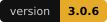
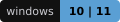
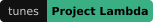
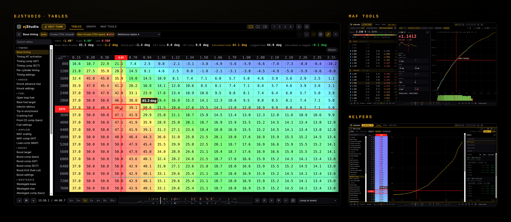
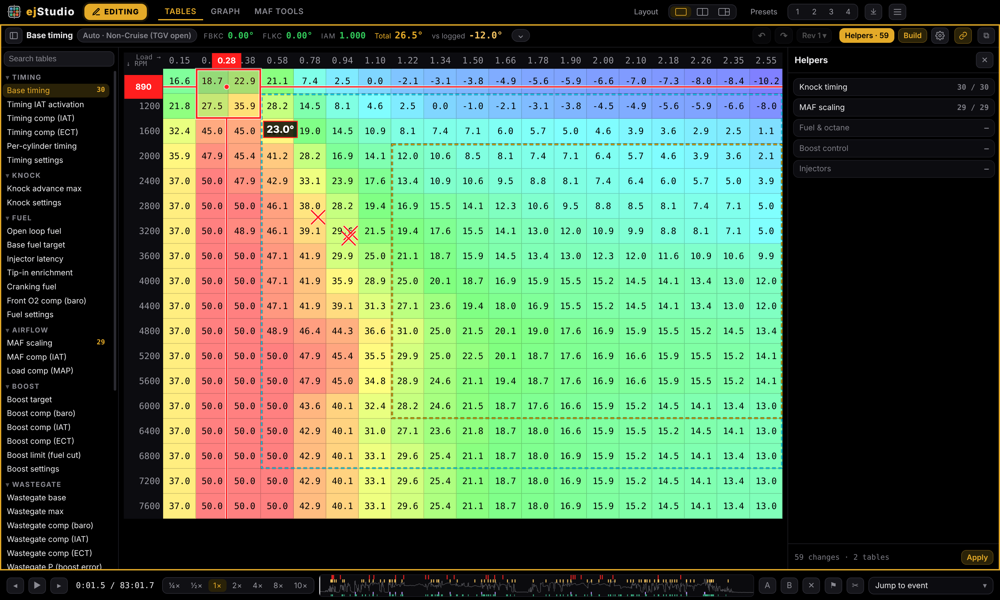
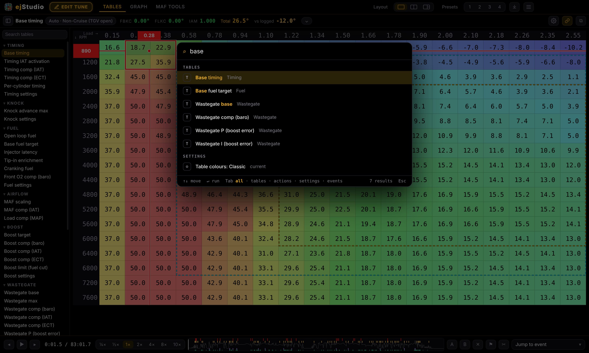
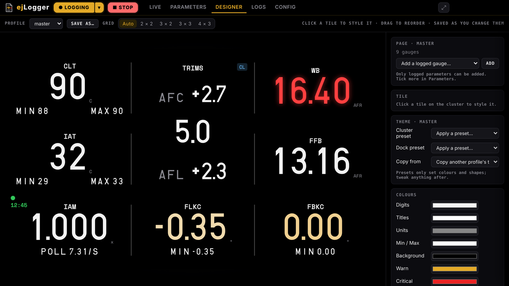
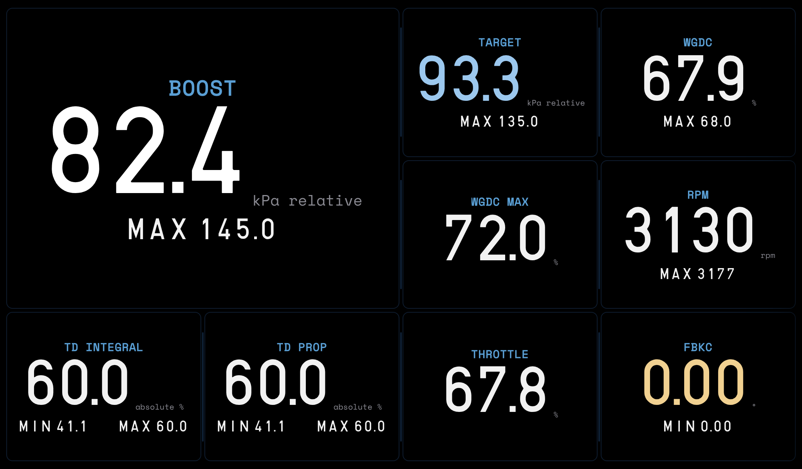
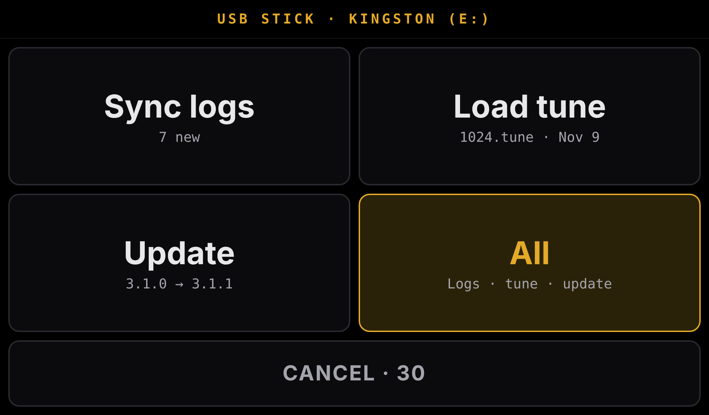
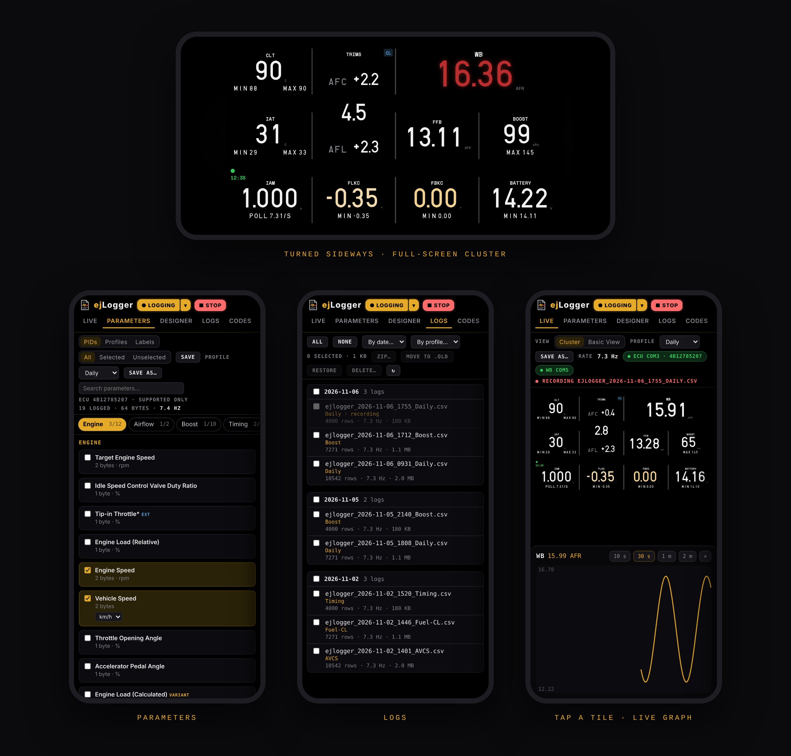

<h1 align="center">ejStudio</h1>

<b>Log analyzer · Tune editor · Live logger</b> for Subaru EJ engines tuned with Project Lambda

  
  
  
  

ejStudio is one app for the whole tuning loop. Load a Project Lambda `.tune` and logs, replay the drive across every table, find knock and fuelling problems, and build the next revision to flash. The built-in logger, **ejLogger**, records the logs, runs an in-car cluster and works from a phone.

<b>Load tune</b> &nbsp;→&nbsp; <b>Drive</b> &nbsp;→&nbsp; <b>Log</b> &nbsp;→&nbsp; <b>Analyze</b> &nbsp;→&nbsp; <b>Edit</b>

Hover the logo in the top-left corner to switch between ejStudio and ejLogger. Logging carries on in the background.

## Install
Download the latest `ejStudio-Setup-x.y.z.exe` from **Releases** and run it. Updates are announced inside the app.

---

# ejStudio

## Tables

Every table in the tune with the log replayed on top: a live crosshair trace, knock heat and marks on the table the ECU was actually using, and live FBKC, FLKC and IAM on the header. Logs recorded on the same revision pool together. 16 colour palettes.

## Edit and build

Type or right-click to set, scale, interpolate and smooth. **Rev N ▾** holds the revision tree and compares. **Build** writes the next `revN.tune` with a backup.

## Helpers

Press **H** for suggested changes from the logs: **Knock timing**, **MAF scaling**, **Fuel & octane**, **Boost control** and **Injectors**. Each shows its evidence and previews every change on the table before you apply it.

> [!IMPORTANT]
> Knock timing only pulls timing for repeated, sustained knock on the current revision, at most 2° per cell, and never adds timing. Added timing after a move to better fuel is off until you tick it.

## MAF Tools

MAF scaling by zone from closed-loop and open-loop corrections, with checks on every bin and the corrected curve beside the current one.

## Graph

Multi-lane graph and scatter with **Jump to event** (knock, boost, fuelling, AVCS, WOT pulls) and two-log compare.

## Projects, palette and settings

- **Projects** keep the tune, logs, revisions and notes in one `.ejsp` file. Ctrl+S, Ctrl+O.
- **Ctrl+K** searches tables, actions, settings, projects and log events.
- **☰** opens the quick menu; **Settings** is a full page with search.
- **Car profiles** keep each car's engine, parts, drivetrain, wideband lag and fuel history.

---

# ejLogger

A Subaru SSM logger, in-car cluster and log manager. Logs are standard CSV.

- **Profiles** switch logged parameters, cluster page, theme and warn limits together.
- **Designer** lays out the cluster per profile.
- **Codes** reads current and stored trouble codes; **Reset ECU** with the engine off.
- **Logs** by day and profile, auto-zipped after 30 days. **▶ Replay** plays a log through the cluster.

## Car mode

**Config → This PC → Car mode** opens ejLogger straight into a full-screen touch cluster that connects on its own and records every drive. Useful on a laptop or tablet that stays in the car.

## USB stick

Plug in a stick to copy logs, load the newest tune or install an update. To move a setup between two PCs, export profiles and cluster layouts from **Config → Car setup**; the other PC shows what changed before applying it, with Undo.

## Phone panel

Open **`ejlogger.local`** on a phone on the same Wi-Fi as ejLogger: the full ejLogger behind a passcode, or a live cluster for passengers.

---

<b>Files and hardware</b>

 

| File | Used for |
|---|---|
| `.tune` | Project Lambda tune: tables, editing, revisions |
| `.ejsp` | ejStudio project |
| `.ejlp` | ejLogger setup |
| `.csv` | Logs from ejLogger, Project Lambda and other SSM loggers |

| | |
|---|---|
| **Protocol** | Subaru SSM over K-Line with continuous fast poll |
| **Hardware** | Tactrix OpenPort (VCP mode), a KKL cable or Project Lambda Bluetooth |
| **Widebands** | AEM UEGO, Innovate LC-2 and PLX on their own port |

Features switch on as channels are found: MAF scaling needs MAF voltage, RPM, wideband and fuel trims; timing analysis needs total timing, FBKC, FLKC and IAM.

## Building from source
Run `build.bat`. It bundles `src\` into `ejstudio.html` and builds the installer into `dist\`.

## Credits
| | |
|---|---|
| **[RomRaider](https://www.romraider.com)** | The SSM logger protocol, logger definitions, profile format and the table knowledge behind the analysis |
| **[Project Lambda](https://lambdatuning.com)** | The `.tune` format and its CSV logs |
| **Space Mono** | Colophon Foundry, SIL Open Font License |
| **Electron** and **serialport** | The desktop app and serial connection |

Private build for personal use. Not for sale or redistribution.
