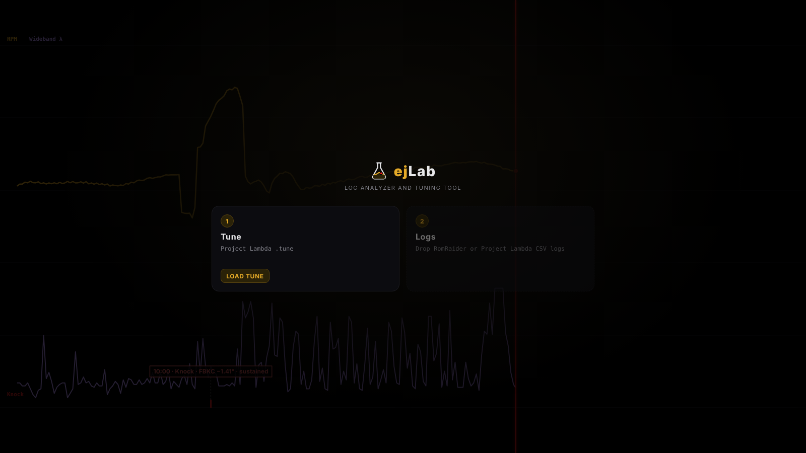
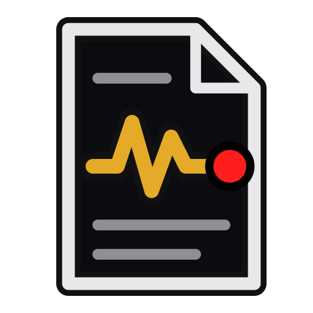
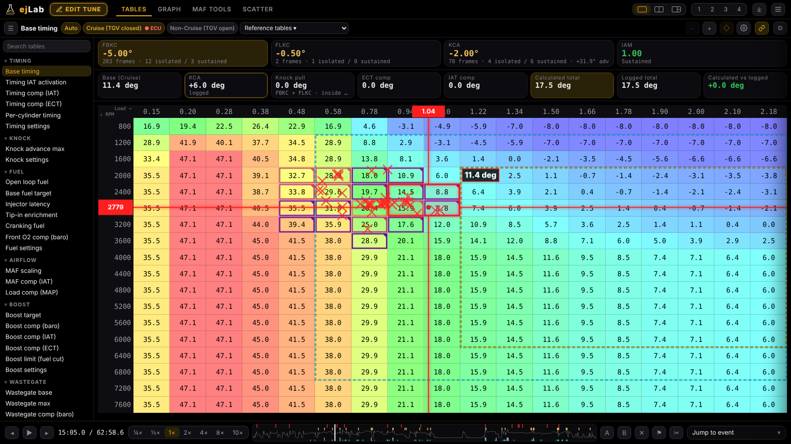
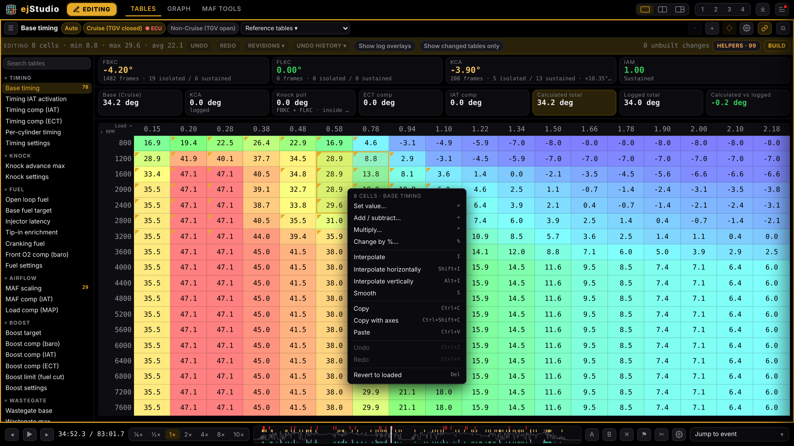
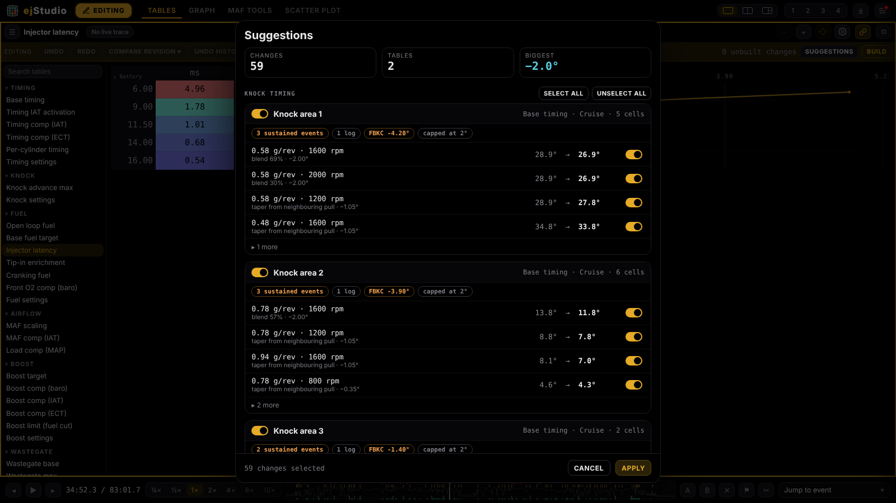
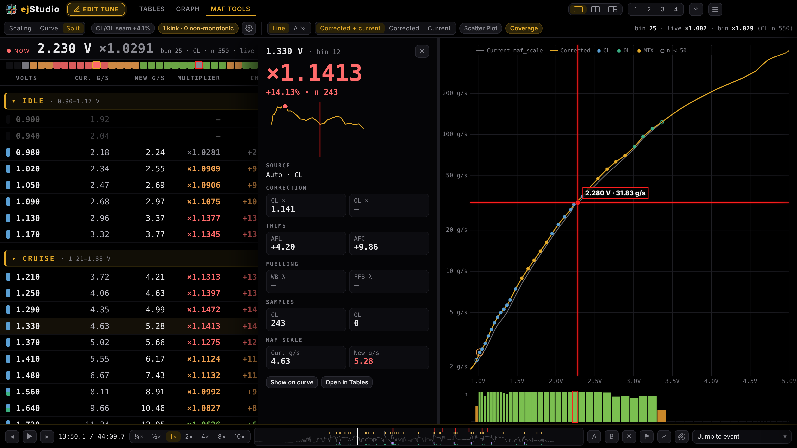
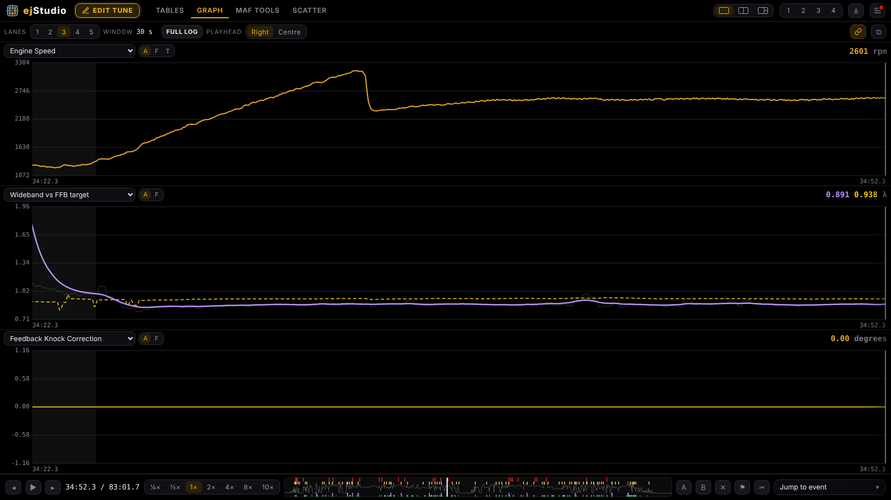
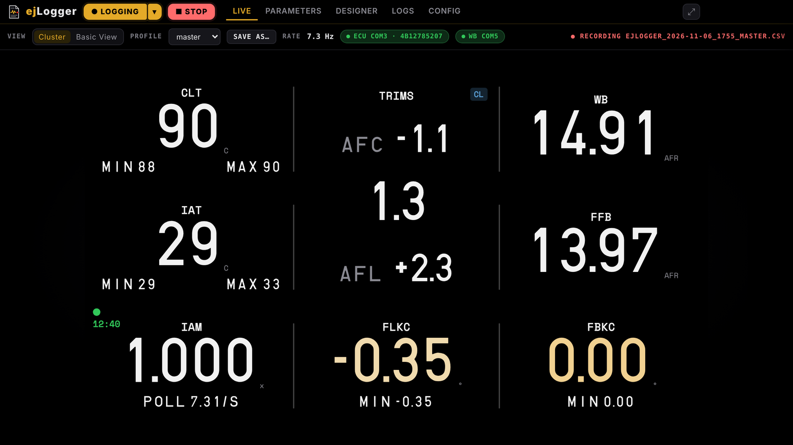
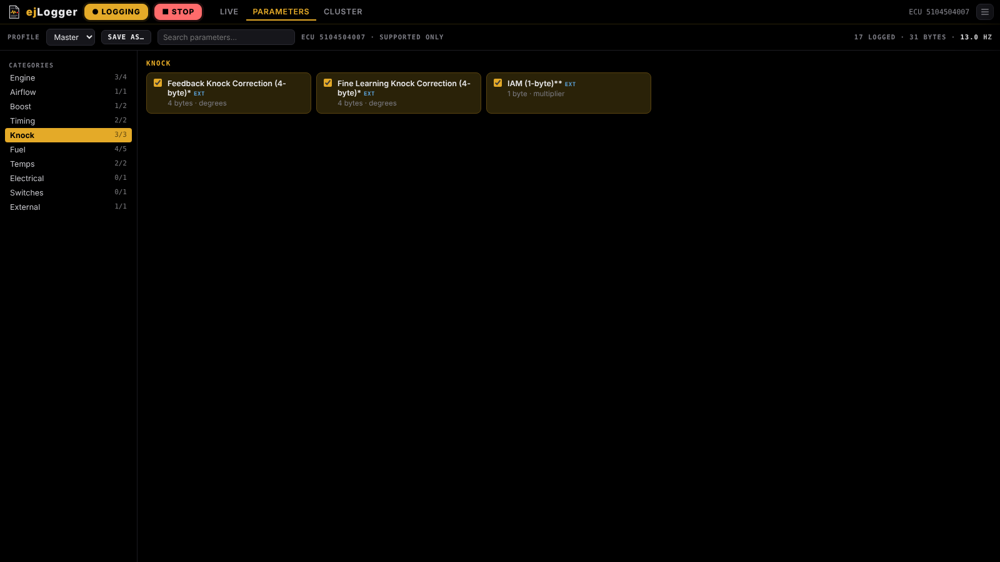

<h1 align="center">ejStudio</h1>

Log analyzer, Project Lambda tune editor and live logger for Subaru EJ engines.

ejStudio loads your logs together with your Project Lambda `.tune`, replays the drive across every table, finds knock and fuelling problems, suggests corrections, and builds a new revision of the tune for you to flash. Its built-in live logger, **ejLogger**, records those logs straight from the car.

## Two modes, one app
| | Mode | What it's for |
|---|---|---|
|  | **ejStudio** | Tables, Graph, MAF Tools, Scatter and tune editing. Opens by default. |
|  | **ejLogger** | Live logging from the ECU: Live, Parameters, Designer and Config. |

Hover the logo in the top-left corner to switch modes, then click and confirm. Each mode has its own top bar and tabs. ejLogger keeps logging in the background while you work in ejStudio, shown by a red dot on the logo.

## Tables

Every table and setting card in the tune, with the log replayed live on top.
- Live crosshair trace that follows playback.
- Knock heat and knock marks, shown only on the table the ECU was actually using at that moment.
- Knock windows (FBKC, FLKC and IAM ranges from the tune), visited-cell and fuel-cut overlays.
- Cruise / Non-Cruise (TGV closed / open) base timing with an **● ECU** marker on the active table.
- Pooled across all logs recorded on the current revision.
- One-axis tables such as MAF scaling are shown vertically with a tall graph.

## Edit tune

Edit any table, axis or setting card directly.
- Right-click menu: set, add, multiply, change by %, interpolate, smooth, copy/paste, undo/redo, revert, copy from another revision.
- Type to edit (`*1.02`, `+0.5`, `-0.35`), arrow keys, selection stats.
- Undo history, read-only compare against any revision.
- **Build** writes a new `revN.tune` and keeps an automatic backup. The original file is never overwritten, and unedited values are written back byte-for-byte.

## Suggestions

MAF scaling and knock timing corrections, grouped by area with the evidence for each.
- Timing follows strict rules: only repeated, sustained knock on the current revision; nothing if IAM has dropped; only the table the ECU was using; spread over the cells the ECU blends; max 2° per cell; tapered with no humps; fuel-cut areas left alone; base timing only; never adds timing.
- Switch any cell or whole group on or off before applying. Nothing reaches the file until you Build.

## MAF Tools

Scaling, Curve, or Both in one tab.
- Zoned scaling list (Idle, Cruise, Load, Boost) with zone averages, an overview strip and a pinned side panel for the selected bin.
- Closed-loop, open-loop and mixed corrections with slope-kink, monotonic and CL/OL agreement checks.
- Corrected vs current curve with the live position.

## Graph and analysis

- Multi-lane graph with Full log view, event ticks and hover details; drag to scrub.
- Searchable Jump to event menu (knock, boost, fuelling, AVCS, tip-in and more).
- Scatter with colour channel and trend lines, two-log compare (A/B), WOT pull splitter, diagnostics timeline, session report.

## ejLogger

A complete Subaru SSM logger that records standard CSV logs, ready to open in ejStudio or any other log tool.
- **Protocol:** Subaru SSM over K-Line (4800 8N1), ECU init `80 10 F0 01 BF 40`, then continuous A8 fast poll. Rate = 480 / (6 + reply bytes) Hz.
- **Standard definitions:** uses the `logger_METRIC_EN_v370.xml` logger definitions and only shows the parameters your ECU supports.
- **Standard CSV logs:** CRLF, `Time (msec)` from 0, `Name (units)` headers and standard number formatting.
- **External widebands:** AEM UEGO (serial), Innovate LC-2 (MTS) and PLX on their own port. A missing wideband port is retried every second and logging carries on without it.
- **Live:** the cluster, built from simple `.properties` files (layout pages, gauge titles and units, warn limits, trims, warm-up), with three-tier warnings, smooth number motion, a TRIMS tile with CL/OL tag, a warm-up ring, poll rate and rec timer. Or Basic View: tiles with min/max, centred and up to six across. Plus the true logged rate, ECU and wideband status, and **Open last log in Graph**.
- **Designer:** click a tile to set its title, colours, sizes and bottom row; drag tiles to reorder, add or remove gauges, and pick the grid. Saved per profile.
- **Cluster settings (Config):** warm-up, warn limits, night dimming, wideband fuel cut and screensavers, saved straight to the cluster files.
- **Screensavers:** Header Pulses, Ink or Night Sky per profile, driven by RPM, throttle blips and coolant temperature. Car cluster only, with a preview in Config.
- **Profiles:** each profile switches the logged parameters and the cluster page together. Import an existing ClusterConfig folder from Config → Cluster files.
- **Parameters:** grouped by category, with units per parameter, plus the bytes and expected rate for your selection. Save selections as profiles.

- **Connect:** one click connects; the button shows Connecting, Settling and Logging. The ▾ beside it opens the ECU port, logger definition and wideband settings, with every serial port on the PC listed.
- **Config:** auto-connect, log folder (default `Documents\ejStudio\logs`) and open in Graph when recording stops.
- **Background engine:** the logger runs as its own process, owning the serial ports, polling and CSV writer, so switching to ejStudio never interrupts a recording. Closing while recording asks first.
- **Desk testing:** the `MOCK` port is a simulated ECU, for trying ejLogger without the car.

Serial ports only (Tactrix OpenPort in VCP mode, a KKL cable or Project Lambda Bluetooth). J2534 is not used.

## Supported files
| File | Source | Used for |
|---|---|---|
| `.tune` | Project Lambda | Tables, editing, building revisions |
| `.csv` logs | ejLogger and other SSM loggers | Everything below |
| `.csv` logs | Project Lambda | Everything below (KCA is estimated from IAM when not logged) |
| `logger_*.xml` | Logger definitions | ejLogger parameters |

Features switch on as channels are found. MAF scaling needs MAF voltage, RPM, wideband and fuel trims; timing analysis needs total timing, FBKC, FLKC and IAM; table traces need the table's axis channels (usually load and RPM).

## Install
Download the latest `ejStudio-Setup-x.y.z.exe` from **Releases** and run it. Updates are announced inside the app. Coming from ejLab? Your settings and tune carry over automatically on first launch.

## Building from source
Run `build.bat`. It bundles `src\` into `ejstudio.html`, installs dependencies, runs the ejLogger engine tests (`ejLogger\engine\test`), runs the self-test against `tests\fixtures`, and builds the installer into `dist\`.

## Roadmap
- **In-car mode:** for a dedicated in-car PC. It boots straight into ejLogger full-screen, with auto-record, screensavers, a warm-up display, warning limits and night dimming.
- **Phone panel:** change cluster settings from a phone on the same network.

## Credits
The logger protocol, logger definitions and table knowledge come from the RomRaider project. The tune format is from Project Lambda.
