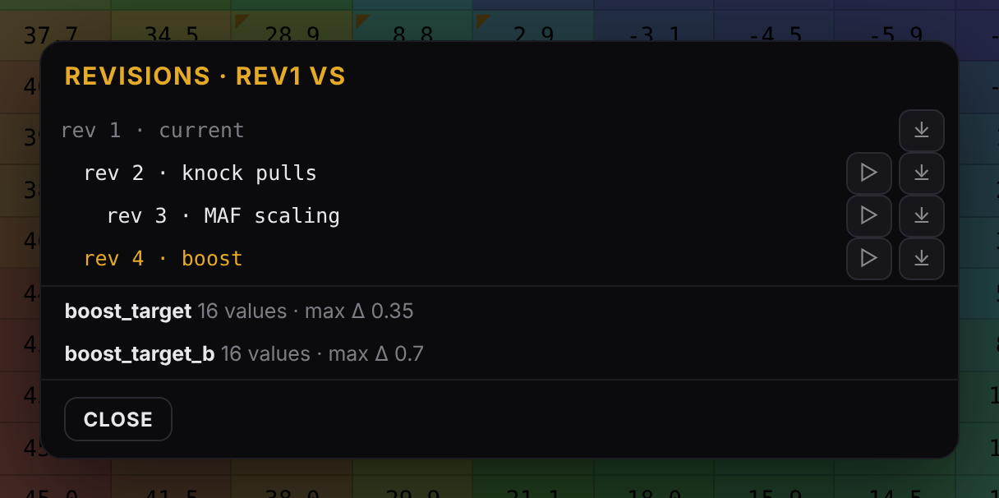
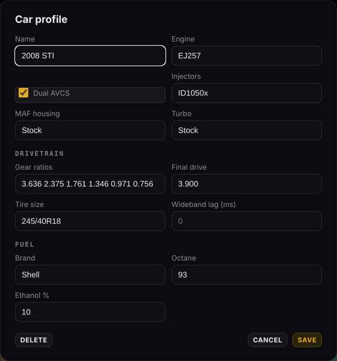
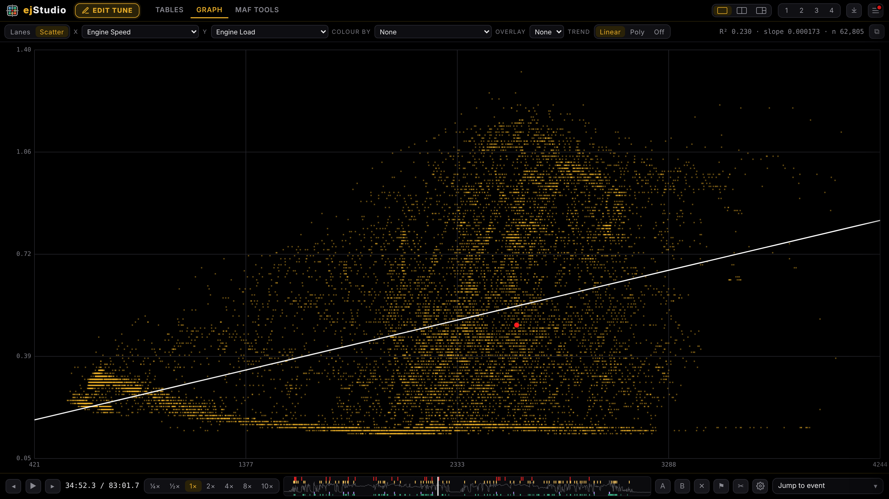
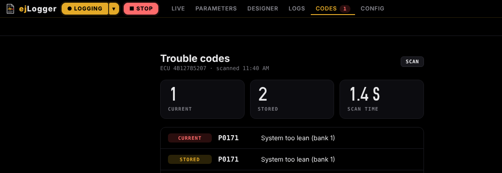
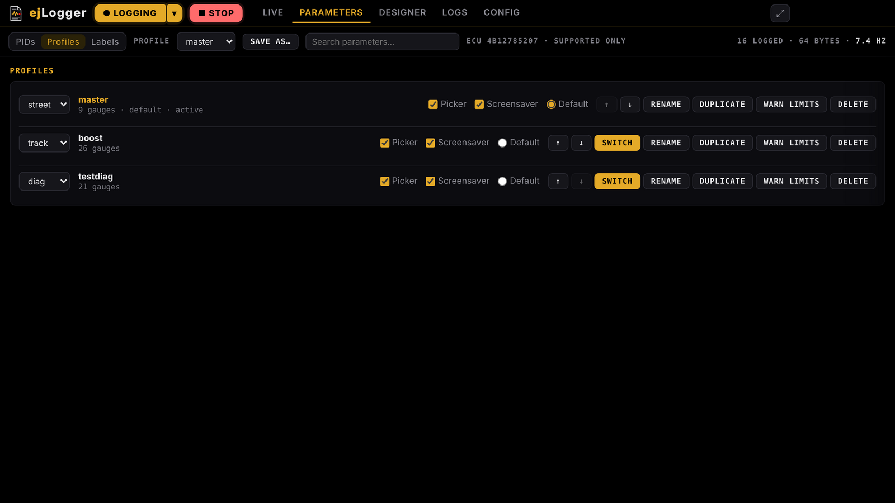
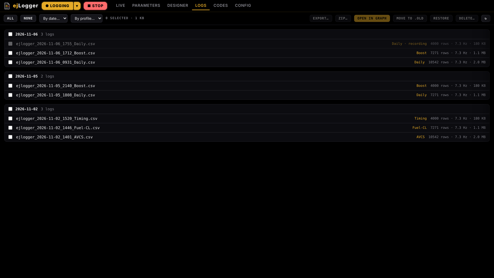
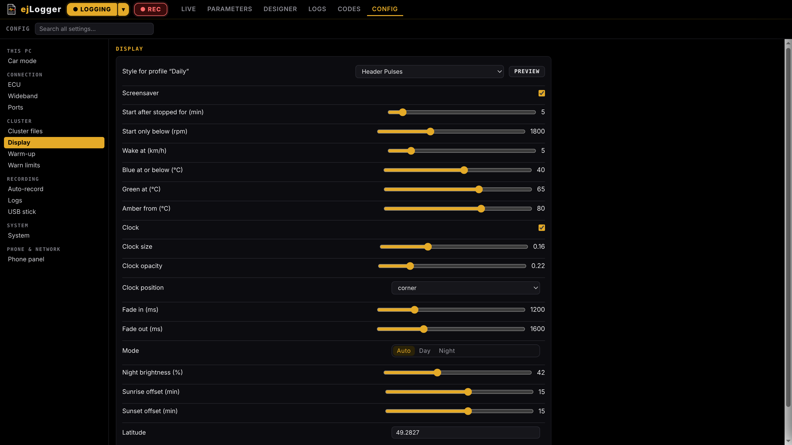
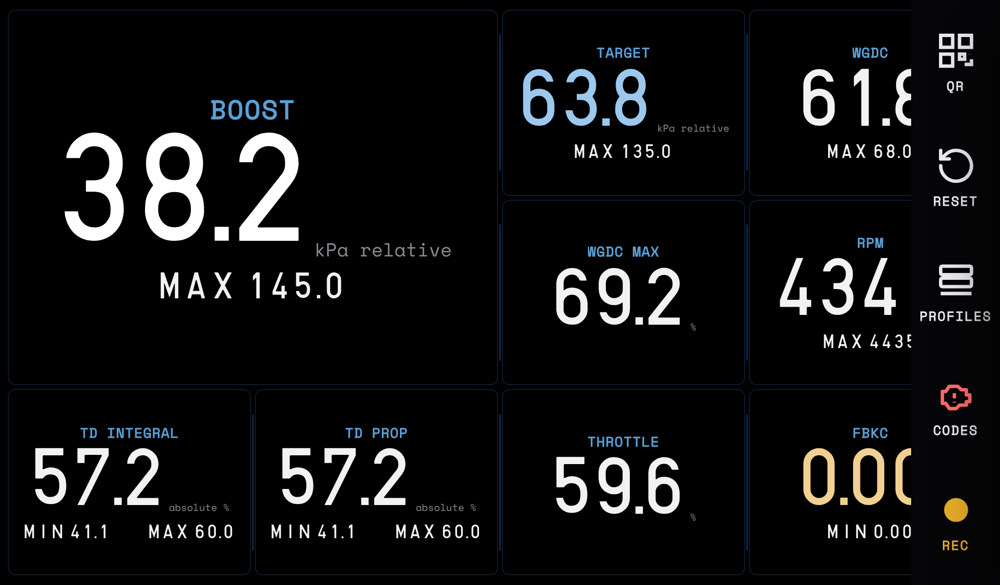

<h1 align="center">ejStudio</h1>

<b>Log analyzer · Tune editor · Live logger</b> for Subaru EJ engines tuned with Project Lambda

  
  
  
  

  <a href="#ejstudio-1">ejStudio</a> ·
  <a href="#ejlogger">ejLogger</a> ·
  <a href="#phone-panel">Phone panel</a> ·
  <a href="#car-pc-mode">Car PC mode</a> ·
  <a href="#install">Install</a> ·
  <a href="#supported-files">Files</a>

ejStudio is one app for the whole tuning loop. It loads logs alongside a Project Lambda `.tune`, replays the drive across every table, finds knock and fuelling problems, suggests corrections and builds the next revision for you to flash. Its built-in logger, **ejLogger**, records those logs from the car, drives an in-car cluster, and puts it all on a phone.

<b>Load tune</b> &nbsp;→&nbsp; <b>Drive</b> &nbsp;→&nbsp; <b>Log</b> &nbsp;→&nbsp; <b>Analyze</b> &nbsp;→&nbsp; <b>Edit</b>

## Two modes, one app

| | Mode | What it's for |
|:-:|---|---|
|  | **ejStudio** | Tables, Graph (lanes and scatter), MAF Tools, Helpers and tune editing. Opens by default. |
|  | **ejLogger** | Live logging: Live cluster, Parameters, Designer, Logs and Config. |

Hover the logo in the top-left corner to switch modes. ejLogger keeps logging in the background while you work in ejStudio, shown by a red dot on the logo.

---

# ejStudio

## Start screen

Pick the car, the tune and the logs, or reopen a recent session. ejLogger's status and newest logs sit alongside.

## Tables

Every table and setting card in the tune, with the log replayed live on top.
- Live crosshair trace that follows playback.
- Knock heat and knock marks, shown only on the table the ECU was actually using at that moment.
- Knock windows (FBKC, FLKC and IAM ranges from the tune), visited-cell and fuel-cut overlays.
- Cruise / Non-Cruise (TGV closed / open) base timing with an **● ECU** marker on the active table.
- Pooled across all logs recorded on the current revision; the chip next to Reference tables picks which logs.
- 16 colour palettes in the table gear (Classic, Traffic, Viridis, Thermal and more). Every mark drawn over the cells switches to colours that stand out on the chosen palette.

## Edit tune

- Right-click menu: set, add, multiply, change by %, interpolate, smooth, copy/paste, undo/redo, revert, copy from another revision.
- Type to edit (`*1.02`, `+0.5`, `-0.35`), arrow keys, selection stats.
- **Revisions ▾**: the tuning tree, a read-only compare against any revision, and open or save any revision. Undo history alongside.
- **Build** writes a new `revN.tune` and keeps an automatic backup.
- Changed cells carry a corner notch; **Changed only** lists just the tables you've touched.
- On timing tables the knock breakdown folds into one line above the table; **Details** opens the full cards.

## Helpers

**Helpers · n** in the edit bar (or **H**) opens the Helpers rail beside the table. Each helper lists its evidence and its changes as groups; picking one jumps the table to where its changes land. Ticked changes are previewed on the table (new value over the old one), unticked ones are outlined, and pending cells carry a mark in the top-right corner while the rail is closed. Apply writes the ticked changes as one undo step and keeps them in the rail as **Done** until **Clear done**. Nothing reaches the file until you Build.

| Helper | Evidence | Changes |
|---|---|---|
| **Knock timing** | Repeated, sustained knock areas with FBKC, FLKC and event counts | Base timing pulls |
| **MAF scaling** | Zoned bins with closed-loop and open-loop corrections | MAF scaling |
| **Fuel & octane** | The car's fuel now and before, stoichiometric AFR | Timing pull after lower octane; added timing after better fuel |
| **Boost control** | Target vs actual boost by RPM at wide-open throttle, peak overshoot, wastegate duty | Wastegate max and base |
| **Injectors** | Closed-loop trims by pulse width | Injector latency; scaling shown for the injector card |

> [!IMPORTANT]
> Knock timing follows strict rules: only repeated, sustained knock on the current revision; nothing if IAM has dropped; only the table the ECU was using; spread over the cells the ECU blends; max 2° per cell; tapered with no humps; fuel-cut areas left alone; base timing only; never adds timing.
>
> The one exception is **Fuel & octane** after a move to better fuel: added timing is its own group, off until ticked, at most 1° per cell per revision, only in cells with 20+ clean samples on the new fuel and nowhere near knock.

## Car profiles

Several cars, each with its engine, parts, drivetrain (gear ratios, final drive, tire size for gear detection), wideband lag (measured from the car's logs unless locked) and fuel history (brand, octane and ethanol % from the pump label). Recent sessions are kept per car, and a tune picks the car it was last loaded with. Switch cars on the start screen or in the drawer; the first launch offers to create one.

 

## MAF Tools

- Scaling, Curve, or Split side by side in one tab.
- Scaling list by zone (Idle, Cruise, Load, Boost): volts, current and new g/s, multiplier, change, samples and CL/OL source, with an overview strip and a side panel for the selected bin (a drawer in narrow panes). Click a row's **CL** or **OL** tag to use only that source for the bin.
- Closed-loop, open-loop and mixed corrections with slope-kink, monotonic and CL/OL agreement checks.
- Corrected vs current curve with the live position.
- OL calc, Source, coverage and filters sit behind the gear.

## Graph and analysis

- Multi-lane graph with Full log view, event ticks and hover details; drag to scrub. Wideband lanes switch between smoothed and raw.
- Searchable **Jump to event** menu: knock, boost, fuelling, AVCS, tip-in and more.
- Scatter mode in the same tab, with colour channel and trend lines.
- Two-log compare: log B draws over Graph, Tables and Scatter.
- WOT pull splitter and diagnostics timeline; diagnostics switch on and off at the top of Jump to event.
- MAF filters, pull detection and replay settings sit behind the gear in their own toolbar.
- Warn limits light up above **Jump to event** in every view, and the matching FBKC, FLKC or IAM value turns red on the table.
- A second Graph opens in split panes.

---

# ejLogger

A complete Subaru SSM logger, cluster and log manager built into ejStudio. Watch the drive on the cluster, or switch to Basic View for one large tile per parameter that fills the screen. Logs are standard CSV, ready for ejStudio or any other log tool.

<table>
<tr>
<td width="33%" valign="top"><b>Fast, standard logging</b> SSM over K-Line with continuous fast poll and the standard logger definitions.</td>
<td width="33%" valign="top"><b>A real in-car cluster</b> Three-tier warnings, warm-up indicator, night dimming, screensavers and a dock.</td>
<td width="33%" valign="top"><b>Runs in the background</b> Switching to ejStudio, or closing a window, never interrupts a recording.</td>
</tr>
<tr>
<td valign="top"><b>Profiles</b> Each profile switches the logged parameters, cluster page, theme and warn limits together.</td>
<td valign="top"><b>Phone panel</b> Full control from a phone, or a live cluster for passengers.</td>
<td valign="top"><b>Car PC mode</b> Boots straight into a full-screen cluster and records every drive.</td>
</tr>
</table>

## Trouble codes

The **Codes** tab reads current and stored codes when ejLogger connects, and again on **Scan**. **Reset ECU** clears them along with the ECU's learned values, and only unlocks with the ignition on and the engine off. In car mode, codes open from the Dock.

## Designer

Lay out the cluster for each profile: click a tile to style it and size it (Wide, Tall, Hero or Banner), drag to reorder, add or remove gauges and pick the grid.

## Parameters and profiles

- **Parameters** grouped by category, with the expected logging rate for the selection. Only what the ECU supports is shown.
- **Profiles** saved as standard profile XML, with their own order, glyph, screensaver and warn limits.
- **Labels** set the title and unit each parameter shows on the cluster.
- **Links** show which 1-, 2- or 4-byte variant has taken over a tile, with unlink.
- **Warn limits** per profile: approach, warn and critical for each gauge on the profile's page, or one set for all profiles.

## Logs

Every log is named by date, time and profile, like `ejlogger_2026-11-06_1755_Daily.csv`. Zip, export, archive or delete them by day or profile; logs older than 30 days are zipped automatically.

## USB stick

Plug a stick in and ejLogger offers what it finds: copy new logs to it, load the newest `.tune` on it, and install a newer `ejStudio-Setup` from it. Car mode shows big touch tiles; the laptop shows a dialog. Updates install silently, with no admin prompt.

## Config

| Section | What's there |
|---|---|
| **This PC** | Car mode |
| **Connection** | ECU port, logger definition, wideband and its fuel-cut display, port names |
| **Cluster** | Cluster files, display (screensaver, night dimming), warm-up, warn limits (shared with ejStudio's analysis) |
| **Recording** | Auto-record, logs (folder, storage, auto-zip), USB stick (any stick, or one label) |
| **System** | Health, restart, config backup |
| **Phone & network** | Phone panel, address and passcode |

---

## Phone panel

Open **`ejlogger.local`** on any phone on the same Wi-Fi as the car PC, and add it to the home screen.

| | Tuner | Live view |
|---|---|---|
| **Who** | You | Passengers |
| **Passcode** | 4 digits, remembered for 30 days | None |
| **What** | The full ejLogger in a phone layout: Live, Parameters, Designer, Logs and Config | The cluster, mirrored exactly, with the profile, REC timer and Reset peaks |
| **Graphs** | Tap any tile | Tap any tile |

Turn the phone sideways for a full-screen cluster. Changes made on the phone show up on the car straight away, and the other way round. Logs and config backups download straight to the phone as zips.

> [!TIP]
> Each install gets its own random passcode. See or change it in **Config → Phone panel**.

## Car PC mode

ejStudio can run a dedicated in-car PC as a full-screen cluster. Turn on **Config → This PC → Car mode**, and from the next launch it:
- opens straight into ejLogger, full screen on the cluster, and loads the default profile;
- connects on its own and keeps retrying until the ECU answers;
- auto-records each drive, with warm-up, warn limits, night dimming and screensavers (Header Pulses, Ink or Night Sky);
- shows the **Dock** with a tap: QR, Reset peaks, Profiles, Codes and Record.

Tap the top edge of the screen or press **Esc** for the full ejLogger.

<b>Under the hood</b>

 

| | |
|---|---|
| **Protocol** | Subaru SSM over K-Line (4800 8N1). ECU init `80 10 F0 01 BF 40`, then continuous A8 fast poll. Rate = 480 / (6 + reply bytes) Hz. |
| **Definitions** | The `logger_METRIC_EN_v370.xml` logger definitions are built in; only the parameters the ECU supports are shown. |
| **CSV format** | CRLF, `Time (msec)` from 0, `Name (units)` headers and standard number formatting. |
| **Widebands** | AEM UEGO (serial), Innovate LC-2 (MTS) and PLX on their own port. A missing wideband port is retried every second and logging carries on without it. |
| **Hardware** | Serial ports only: Tactrix OpenPort in VCP mode, a KKL cable or Project Lambda Bluetooth. J2534 is not used. |
| **Engine** | Runs as its own process, owning the serial ports, polling and CSV writer. Closing while recording asks first. |
| **Desk testing** | The `MOCK` port is a simulated ECU, for trying ejLogger without the car. |
| **Cluster files** | Plain `.properties` files (pages, themes, gauges, labels, trims, warn limits, display, warm-up, dimming, screensaver, record, profile settings) plus profile XML. Import an existing ClusterConfig folder from **Config → Cluster files**: only the files ejLogger uses come across. |

---

## Supported files
| File | Source | Used for |
|---|---|---|
| `.tune` | Project Lambda | Tables, editing, building revisions |
| `.csv` logs | ejLogger and other SSM loggers | Everything below |
| `.csv` logs | Project Lambda | Everything below |
| `logger_*.xml` | Logger definitions | ejLogger parameters |
| `profiles\*.xml` | Logger profiles | ejLogger profiles |

Features switch on as channels are found. MAF scaling needs MAF voltage, RPM, wideband and fuel trims; timing analysis needs total timing, FBKC, FLKC and IAM; table traces need the table's axis channels (usually load and RPM).

## Install
Download the latest `ejStudio-Setup-x.y.z.exe` from **Releases** and run it. Updates are announced inside the app.

## Building from source
Run `build.bat`. It bundles `src\` into `ejstudio.html`, installs dependencies and builds the installer into `dist\`.

## Credits
ejStudio grew out of tooling built around **[RomRaider](https://www.romraider.com)** and **[Project Lambda](https://lambdatuning.com)**.

| | |
|---|---|
| **RomRaider** | The SSM logger protocol, logger definitions, profile format and the table knowledge behind the analysis. |
| **Project Lambda** | The `.tune` format and its CSV logs. |
| **Open-Meteo** | Weather data from [open-meteo.com](https://open-meteo.com), CC BY 4.0. |
| **Space Mono** | Monospace type by Colophon Foundry, SIL Open Font License. |
| **Electron** and **serialport** | The desktop app and the serial connection to the ECU and widebands. |

Private build for personal use. Not for sale or redistribution.
